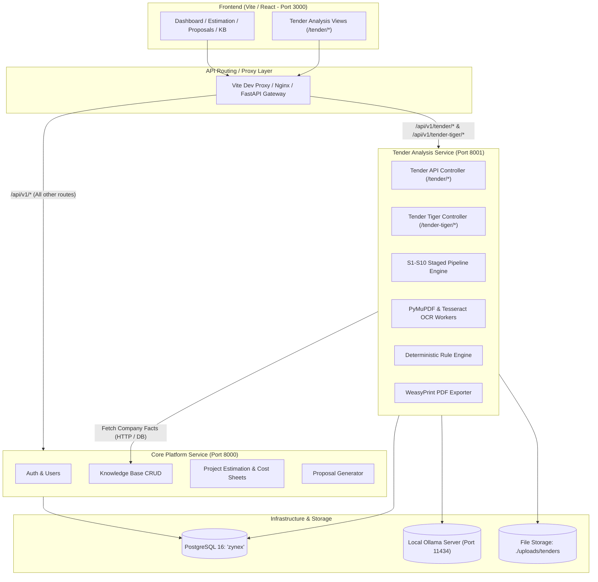
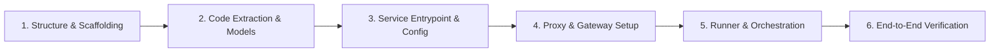

# Architectural Plan: Decoupling Tender Analysis into a Standalone Service

This document outlines the step-by-step engineering plan to extract the **Tender Analysis Engine** from the current monolithic backend into a dedicated, modular microservice (**`tender-service`**).

---

## 1. Executive Summary & Objectives

### Current State
* The backend currently hosts all modules in a single FastAPI application (`backend/` on port `8000`):
  - Identity & Access Management (Auth, Roles, Users)
  - Project Estimation & WBS Cost Calculation
  - Proposal Generator
  - Knowledge Base (Clients, Employees, Projects, Technologies, Certifications)
  - **Tender Analysis Engine (S1–S10 Pipeline, PyMuPDF, Tesseract OCR, RapidFuzz)**
  - **Tender Tiger Integration (`tt_*` tables & scraper portal)**

### Target State
* **Main Core Service (`core-service`, Port 8000)**: Auth, Knowledge Base, Estimation, Proposals, Settings.
* **Tender Analysis Service (`tender-service`, Port 8001)**: Dedicated service handling document ingestion, heuristic gating, OCR, structure parsing, neural criteria extraction (Ollama), rule engine validation, PDF report export, and Tender Tiger.
* **Zero Disruption to Frontend**: An API Gateway / Reverse Proxy layer ensures existing frontend routes (`/api/v1/tender/*` and `/api/v1/tender-tiger/*`) continue working seamlessly without rewriting UI components.

---

## 2. Target Architecture Overview



---

## 3. Service Boundaries & Extraction Inventory

### Files to Migrate to `services/tender-service/`

| Component | Source Files | Role in Standalone Service |
|---|---|---|
| **API Routers** | `app/api/v1/tender.py`<br>`app/api/v1/eligibility.py`<br>`app/api/v1/tender_tiger.py` | Standalone HTTP controllers for uploads, status polling, stage inspector, reports, and Tender Tiger. |
| **Pipeline Core** | `app/services/eligibility/pipeline.py`<br>`app/services/eligibility/file_validator.py`<br>`app/services/eligibility/structure_analyzer.py`<br>`app/services/eligibility/chunker.py`<br>`app/services/eligibility/locator.py`<br>`app/services/eligibility/prefilter.py` | S1 through S5 parsing, filtering, and clause segmentation. |
| **Extraction & AI** | `app/ai/tender/*`<br>`app/ai/llm_client.py` | Neural criteria extraction prompts, Ollama HTTP client, schema retry parsers. |
| **Grounding & Audit** | `app/services/eligibility/post_validator.py`<br>`app/services/eligibility/normalizer.py`<br>`app/services/eligibility/rule_engine.py`<br>`app/services/eligibility/verdict.py`<br>`app/services/eligibility/reasoning.py` | RapidFuzz quotation verifier, unit converter, deterministic rule engine. |
| **Parsers & OCR** | `app/parsers/*`<br>`app/services/eligibility/pdf_extractor.py`<br>`app/services/eligibility/ocr_service.py` | PyMuPDF text & table extractors, Tesseract image-to-text engine. |
| **Exporters** | `app/services/eligibility/report_pdf.py` | Multi-page Jinja2 / WeasyPrint PDF report builder. |
| **Models & Schemas** | `app/models/tender.py`<br>`app/models/document.py`<br>`app/schemas/eligibility.py`<br>`app/schemas/tender.py` | Database models for `eligibility_reports`, `tender_chunks`, `documents`, `tt_*`. |

---

## 4. Key Architectural Decisions (To Align & Approve)

### Decision 1: Inter-Service Communication for Company Facts (Stage S9)
In Stage S9, the Rule Engine evaluates criteria against company facts (Turnover, Certifications, Headcount, Projects).
* **Option A (Direct Database Access - Recommended for Phase 1)**:  
  Both services connect to the `zynex` PostgreSQL database. The Tender Service performs read-only queries on `certifications`, `financial_records`, `employees`, `projects`, and `technologies`.
  * *Pros*: Zero network overhead, zero latency, guaranteed transaction consistency, easiest migration.
* **Option B (REST API Contract)**:  
  The Tender Service calls Core Backend: `GET /api/v1/kb/company-facts`.
  * *Pros*: Strict microservice boundary isolation.
  * *Cons*: Adds network hop and serialization overhead.

> **Recommendation**: Start with **Option A** (shared database, isolated domain tables) to guarantee zero regressions, with a clean `CompanyFactsClient` abstraction that can switch to Option B later.

---

### Decision 2: Authentication & Token Validation
* The Tender Service will share the same `SECRET_KEY` and algorithm as Core Backend.
* Incoming requests pass the standard JWT Bearer token; the Tender Service validates the token locally using `app.core.security.decode_token` without needing an HTTP round-trip to the Core Backend.

---

### Decision 3: Routing & Gateway Strategy
* To ensure the frontend requires **zero URL changes**, we will update the Vite dev proxy (`frontend/vite.config.ts`) and production deployment config:
  ```typescript
  // Vite proxy routing
  proxy: {
    '/api/v1/tender': { target: 'http://localhost:8001' },
    '/api/v1/tender-tiger': { target: 'http://localhost:8001' },
    '/api/v1/eligibility': { target: 'http://localhost:8001' },
    '/api/v1': { target: 'http://localhost:8000' },
  }
  ```

---

## 5. Detailed Step-by-Step Implementation Roadmap



### Step 1: Project Scaffolding
* Create directory structure:
  ```
  services/tender_service/
  ├── app/
  │   ├── api/v1/          # tender.py, eligibility.py, tender_tiger.py
  │   ├── core/            # config.py, security.py, database.py
  │   ├── services/        # pipeline, parsing, ocr, rule_engine, pdf
  │   ├── ai/              # criteria_extractor, llm_client
  │   ├── models/          # eligibility_report, tender_chunk, document
  │   └── schemas/         # eligibility schemas, criteria DTOs
  ├── scripts/             # seed_tender_tiger.py
  ├── main.py              # FastAPI app listening on port 8001
  ├── requirements.txt     # Specialized requirements (PyMuPDF, WeasyPrint, pytesseract)
  └── Dockerfile
  ```

### Step 2: Extract Dependencies & Heavy Libraries
* Relieve the core backend of heavy binary dependencies (`pymupdf`, `weasyprint`, `pytesseract`, `rapidfuzz`).
* Core backend requirements become lightweight, while `tender_service` manages document-processing dependencies.

### Step 3: Implement Standalone Entrypoint (`services/tender_service/main.py`)
* Configure FastAPI with CORS, lifespan startup tasks, exception handlers, and the `/api/v1` routers for `tender`, `eligibility`, and `tender-tiger`.

### Step 4: Configure Frontend Proxy
* Update [`frontend/vite.config.ts`](file:///home/xenovex/xos-tender-engine/frontend/vite.config.ts) to route `/api/v1/tender` and `/api/v1/tender-tiger` requests to port `8001`.

### Step 5: Update Master Startup Runner ([`run`](file:///home/xenovex/xos-tender-engine/run))
* Update the `./run` script to launch:
  1. Core Backend: `http://localhost:8000`
  2. Tender Service: `http://localhost:8001`
  3. Frontend: `http://localhost:3000`
* Add graceful cleanup trap to stop all 3 processes on `Ctrl+C`.

### Step 6: End-to-End Validation
* Validate Tender Upload $\to$ S1–S10 execution $\to$ Stage Inspector $\to$ PDF Export $\to$ Tender Tiger.

---

## 6. Risk Assessment & Mitigations

| Risk | Mitigation |
|---|---|
| **Port Conflicts** | Allocate explicit dedicated port (`8001`) with cleanup command (`fuser -k 8001/tcp`) in `./run`. |
| **JWT Desynchronization** | Share `SECRET_KEY` between `backend/.env` and `services/tender_service/.env`. |
| **Heavy OCR / PDF Processing Blocking Event Loop** | Ensure all PyMuPDF, WeasyPrint, and Tesseract calls execute inside `asyncio.to_thread` workers (already standard in the current pipeline). |
| **Downtime during Migration** | Keep the existing routers in the core backend active as fallbacks until `tender_service` passes verification. |
