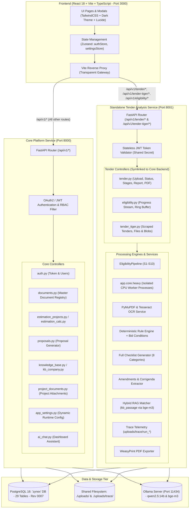

# ZYNEX Platform: End-to-End Architecture, Interaction Trace & Database Dictionary

This document provides a complete technical analysis of the **ZYNEX** platform (**Z**ero-Cloud, **Y**our-Data, **N**eural **E**stimation & e**X**ecution). It traces every single user interface action, node, and button click end-to-end through the frontend components, API clients, backend FastAPI controllers, background services, neural models, and the underlying PostgreSQL database (`zynex`).

---

## 1. System Architecture & Multi-Service Topology

The ZYNEX platform is architected as a modular, decoupled system with two distinct backend services, an isolated CPU worker execution pool, and a unified React frontend:



### Technology Matrix & Service Allocation
* **Frontend**: React 18, TypeScript, Vite, Tailwind CSS, Dark Mode System (`theme-dark.css`), Lucide React, React Router v6, Axios, Zustand (Port 3000).
* **Core Service (`backend/`)**: FastAPI, SQLAlchemy 2.0 (Asyncpg), Alembic, Pydantic v2 (Port 8000). Handles Authentication, Knowledge Base 9-Tab Corporate Master, Semantic Indexing, Project Estimation, Proposal Generator, System Settings, and Dashboard AI chat.
* **Tender Analysis Service (`services/tender_service/`)**: Standalone FastAPI service (Port 8001). Utilizes symlinks into `backend/app/` to ensure a single source of truth without code duplication. Handles Ingestion, PyMuPDF parsing, Tesseract OCR, S1–S10 criteria extraction pipeline, RapidFuzz grounding, Hybrid Semantic Matching with `bge-m3`, Deterministic Rule Engine, Bid Conditions & Conflict Extraction, Corrigendum/Amendment extraction, Full 8-category Tender Checklist generation, WeasyPrint PDF reports, and Tender Tiger integration.
* **CPU Worker Layer (`app.core.heavy`)**: Multiprocessing worker process isolation with timeouts for CPU-heavy stages (PDF extraction, structure analysis, chunking, quote grounding). Prevents GIL stalls on large tenders (60+ pages / 2MB+).
* **Database**: PostgreSQL 16 on `localhost:5432` (or local port 5433), Database: `zynex`, Head Revision: `0007` (**29 tables**).
* **AI / Neural Tier**: Local or networked Ollama Server on port `11434` (configurable via `ai.ollama_url`):
  * **LLM Engine**: `qwen2.5:14b` (default fallback: `llama3.1:8b`).
  * **Embedding Engine**: `bge-m3` (hybrid meaning retrieval for company experience & personnel) and `nomic-embed-text` (project documents).

---

## 2. End-to-End Node & User Interaction Trace

This section details what happens under the hood when a user interacts with every primary node, tab, and button across the application.

---

### Module 1: Authentication & Session Lifecycle

#### 1.1 "Sign In" Button Click
* **Trigger Node**: "Sign In" button in [`LoginPage.tsx`](file:///home/xenovex/xos-tender-engine/frontend/src/pages/auth/LoginPage.tsx).
* **Frontend Component**: `LoginPage` $\to$ form submit handler `handleSubmit(e)`.
* **Frontend Service**: [`useAuthStore.getState().login(email, password)`](file:///home/xenovex/xos-tender-engine/frontend/src/store/authStore.ts).
* **HTTP Dispatch**:
  ```http
  POST /api/v1/token HTTP/1.1
  Content-Type: application/x-www-form-urlencoded

  username=you@company.com&password=AdminPassword123!
  ```
* **Backend Controller**: [`app.api.v1.auth.login_for_access_token`](file:///home/xenovex/xos-tender-engine/backend/app/api/v1/auth.py#L22).
* **Business Logic**:
  1. Calls `authenticate_user(db, form_data.username, form_data.password)`.
  2. Queries `users` table joined with `roles` table.
  3. Validates password hash with `passlib.context.CryptContext.verify` (bcrypt).
  4. Checks `user.is_active == True`.
  5. Creates signed JWT containing claims: `sub` (email), `id` (int), `role` (role name string), `full_name` (string), and `exp` timestamp.
* **Database Tables Touched**:
  - `users` (`SELECT * FROM users WHERE email = :email LIMIT 1`)
  - `roles` (`SELECT * FROM roles WHERE id = :role_id LIMIT 1`)
* **State / Mutation**:
  - Client saves JWT to `localStorage.setItem('token', token)`.
  - Client updates Zustand `authStore` (`user`, `token`, `role`, `fullName`).
  - React Router redirects browser to `/dashboard`.

#### 1.2 Protected Route Access & Token Verification
* **Trigger Node**: Any URL navigation or browser page reload.
* **Frontend Component**: [`ProtectedRoute.tsx`](file:///home/xenovex/xos-tender-engine/frontend/src/components/common/ProtectedRoute.tsx).
* **Mechanism**:
  - Checks `authStore.token`. If missing, immediately redirects to `/login`.
  - Inspects token role against `allowedRoles`. If insufficient permissions, renders Access Denied view.
  - Injects `Authorization: Bearer <token>` header into all outbound Axios requests via [`client.ts`](file:///home/xenovex/xos-tender-engine/frontend/src/api/client.ts).

#### 1.3 "Log Out" Button Click
* **Trigger Node**: LogOut icon button in the header of [`AppShell.tsx`](file:///home/xenovex/xos-tender-engine/frontend/src/components/layout/AppShell.tsx).
* **Frontend Handler**: `handleLogout()`.
* **Action**: Clears `localStorage` auth tokens, resets `authStore`, and redirects browser to `/login`. No server-side DB session mutation required (stateless JWT).

---

### Module 2: Dashboard & Real-Time AI Assistant

#### 2.1 Dashboard Screen Initialization
* **Trigger Node**: Navigating to `/dashboard` tab in [`DashboardPage.tsx`](file:///home/xenovex/xos-tender-engine/frontend/src/pages/analyst/DashboardPage.tsx).
* **Frontend Service**: [`documentsApi.list()`](file:///home/xenovex/xos-tender-engine/frontend/src/api/documents.ts).
* **HTTP Dispatch**:
  ```http
  GET /api/v1/documents/ HTTP/1.1
  Authorization: Bearer <jwt>
  ```
* **Backend Controller**: [`app.api.v1.documents.list_documents`](file:///home/xenovex/xos-tender-engine/backend/app/api/v1/documents.py#L170).
* **Business Logic**:
  - If current user is `admin`, selects all documents.
  - If `analyst` or `viewer`, filters documents by `uploaded_by == current_user.id`.
* **Database Tables Touched**:
  - `documents` (`SELECT * FROM documents ORDER BY created_at DESC`)
* **UI Update**:
  - Computes aggregation metrics: Total Documents, Analyzed count, Processing count, Failed count.
  - Renders recent documents in the summary table with colored status badges.

#### 2.2 Inline AI Assistant Message Dispatch
* **Trigger Node**: "Send" button click or suggestion pill click in [`AIChatWidget`](file:///home/xenovex/xos-tender-engine/frontend/src/pages/analyst/DashboardPage.tsx#L19-L180).
* **Frontend Service**: [`streamChat({ messages, model, temperature, onChunk, onDone })`](file:///home/xenovex/xos-tender-engine/frontend/src/api/streamChat.ts).
* **HTTP Dispatch**:
  ```http
  POST /api/v1/ai/chat/stream HTTP/1.1
  Content-Type: application/json

  {"messages": [{"role": "user", "content": "How do I estimate a mobile app?"}], "model": "qwen2.5:14b", "temperature": 0.2}
  ```
* **Backend Controller**: [`app.api.v1.ai_chat.stream_chat`](file:///home/xenovex/xos-tender-engine/backend/app/api/v1/ai_chat.py#L48).
* **Business Logic**:
  - Reads active default model from `settings.AI_DEFAULT_MODEL` (fallback to registry).
  - Establishes Server-Sent Events (SSE) streaming connection with local Ollama (`POST /api/chat`).
  - Streams response tokens chunk-by-chunk over HTTP streaming response (`text/event-stream`).
* **Database Tables Touched**:
  - `app_settings` (Cached lookup for active AI model and Ollama endpoint).
* **UI Update**:
  - Assistant message bubble updates in real time on every incoming token.

---

### Module 3: Tender Analysis Suite

> [!NOTE]
> **Service Architecture Note**:
> All routes under this module (`/api/v1/tender/*`, `/api/v1/tender-tiger/*`, `/api/v1/eligibility/*`) are served by the decoupled **Standalone Tender Analysis Service (Port 8001)**. Requests originating from the browser (`http://localhost:3000`) are transparently forwarded by the Vite Gateway Proxy to Port 8001.

#### 3.1 "Analyze Tender" File Upload
* **Trigger Node**: "Analyze Tender" button in [`Upload.tsx`](file:///home/xenovex/xos-tender-engine/frontend/src/features/tender/pages/Upload.tsx).
* **Frontend Service**: [`tenderApi.uploadTender(file, options)`](file:///home/xenovex/xos-tender-engine/frontend/src/features/tender/api.ts).
* **HTTP Dispatch**:
  ```http
  POST /api/v1/tender/upload HTTP/1.1
  Host: localhost:3000 (proxied -> localhost:8001)
  Content-Type: multipart/form-data

  file: <NIT_Tender_Document.pdf>
  model: "qwen2.5:14b"
  ocr: true
  fast_mode: false
  ```
* **Hosting Service**: Standalone Tender Analysis Service (`services/tender_service/`, Port 8001).
* **Backend Controller**: [`app.api.v1.tender.upload_tender`](file:///home/xenovex/xos-tender-engine/backend/app/api/v1/tender.py#L142).
* **Business Logic & Processing Flow**:
  1. **Pre-Validation Gate**: Checks file extension (`.pdf`), verifies file is unencrypted, and runs heuristic keyword scoring (`file_validator.py`).
  2. **File Persistence**: Writes binary to disk at `UPLOAD_DIR/<uuid>.pdf` (shared disk volume symlinked to `backend/uploads`).
  3. **Database Registration**:
     - Inserts record into `documents` table (`status="ANALYZED"`).
     - Inserts record into `eligibility_reports` table (`status="PENDING"`).
  4. **Background Pipeline Execution**:
     - Spawns background asynchronous task: `asyncio.create_task(_run_pipeline(report.id, doc.id, filepath, ...))`.
     - Strong reference retained in global dictionary `_TASKS[report.id]`.
* **Database Tables Touched**:
  - `documents` (`INSERT INTO documents ... RETURNING id`)
  - `eligibility_reports` (`INSERT INTO eligibility_reports ... RETURNING id`)
* **UI Update**:
  - Returns `{ run_id: report.id, document_id: doc.id, status: "pending" }`.
  - Frontend router redirects immediately to `/tender/processing/:runId`.

#### 3.2 Live Pipeline Processing & Stepper Updates
* **Trigger Node**: Mount of [`Processing.tsx`](file:///home/xenovex/xos-tender-engine/frontend/src/features/tender/pages/Processing.tsx).
* **Frontend Service**: Periodic polling (`setInterval` every 1000ms):
  - `tenderApi.getStatus(runId)` $\to$ `GET /api/v1/tender/{run_id}/status`
  - `tenderApi.getProgress(docId)` $\to$ `GET /api/v1/eligibility/{doc_id}/progress`
* **Backend Controllers**:
  - [`app.api.v1.tender.get_status`](file:///home/xenovex/xos-tender-engine/backend/app/api/v1/tender.py#L205): Queries `eligibility_reports` status and stage counters.
  - [`app.api.v1.eligibility.get_progress`](file:///home/xenovex/xos-tender-engine/backend/app/api/v1/eligibility.py#L230): Reads from in-memory ring buffer `progress_store`.
* **The S1–S10 Processing Execution (Under the Hood)**:
  - **S1 (File Gate)**: Pure CPU validation of PDF structure. Big files (> 2MB) isolated via `app.core.heavy.run_stage`.
  - **S2a (Extraction)**: PyMuPDF parses text, bounding boxes, and detects table vectors.
  - **S2b (OCR)**: Tesseract runs on scanned pages rasterized at 216 DPI.
  - **S3 (Structure)**: Hierarchical node tree constructed (chapters, clauses, tables).
  - **S4 (Chunking)**: Nodes grouped into page-bounded `ChunkSchema` models.
  - **S5 (Section Locator)**: Scans for Pre-Qualification anchors, filtering out boilerplate.
  - **S6 (Neural Extraction & Auxiliary Analyzers)**:
    - Calls local Ollama (`qwen2.5:14b`) extracting criteria JSON with verbatim quotes.
    - Runs **Bid Conditions Analyzer** (`bid_conditions.py`) for deterministic regex extraction of EMD, tender fee, consortium rules, subcontracting rules, and source code handover clauses.
    - Runs **Conflict Detector** (`bid_conditions.py`) catching conflicting numbers/clauses stated across different tender pages.
    - Runs **Corrigendum / Amendment Parser** (`amendments.py`).
    - Runs **Full Checklist Generator** (`checklist.py`) across 8 categories (Eligibility, Scope, Deliverables, Timeline, Commercial, Submission forms, Evaluation, Obligations).
  - **S7 (Grounding Check)**: RapidFuzz computes partial matching of quotes against source chunks. Isolated in heavy worker process if chunks > 150.
  - **S8 (Normalizer)**: Converts Crore/Lakh/USD units into canonical floats and standardizes dates.
  - **S9 (Master Audit)**: Rule Engine queries:
    - **Exact Facts**: `financial_records`, `certifications`, `employees`, `projects`, `technologies`, `company_profile`, `company_offices`, `oem_partnerships`.
    - **Semantic Meaning Matching**: Hybrid vector search against `kb_passage` using `bge-m3` float array embeddings (65% meaning + 35% domain vocabulary) for past projects and personnel roles. Fallback to keyword-only if Ollama is unreachable. Matches found only by meaning are flagged as **check by hand**.
    - **Placeholder Safety Gate**: Any value marked `is_sample = true` is never allowed to decide a PASS or FAIL; it is flagged as "check by hand" prompting the user to verify.
  - **S10 (Verdict & Trace)**: Synthesizes final `ELIGIBLE`, `NOT_ELIGIBLE`, or `PARTIAL` decision. If `tender.trace_runs = True`, writes full diagnostic text dumps to `./uploads/trace/run_<id>_<file>/`.
* **Database Tables Touched during Pipeline**:
  - `financial_records`, `certifications`, `employees`, `projects`, `technologies`, `company_profile`, `company_offices`, `oem_partnerships`, `kb_passage`.
  - `eligibility_reports` (Stage 10 final UPDATE with criteria array, compliance matrix, full checklist, bid conditions, and stage logs).
* **UI Update**:
  - Live progress stepper updates stages S1 $\to$ S10. Terminal displays log lines.
  - Upon reaching `status === "completed"`, automatically navigates to `/tender/report/:runId`.

#### 3.3 "Cancel Analysis" Button Click
* **Trigger Node**: "Cancel" button on `Processing.tsx`.
* **Frontend Service**: `tenderApi.cancelRun(runId)`.
* **HTTP Dispatch**: `POST /api/v1/tender/{run_id}/cancel`.
* **Backend Controller**: [`app.api.v1.tender.cancel_run`](file:///home/xenovex/xos-tender-engine/backend/app/api/v1/tender.py#L221).
* **Business Logic**:
  - Retrieves task from `_TASKS[run_id]`.
  - Sets internal `cancelled = True` token and cancels asyncio task.
  - Updates `eligibility_reports.status = "CANCELLED"`.
* **Database Tables Touched**:
  - `eligibility_reports` (`UPDATE eligibility_reports SET status = 'CANCELLED' WHERE id = :run_id`).

#### 3.4 Report View & Criteria Filter Interactions
* **Trigger Node**: Mount and filter clicks in [`Report.tsx`](file:///home/xenovex/xos-tender-engine/frontend/src/features/tender/pages/Report.tsx).
* **Frontend Service**: `tenderApi.getReport(runId)` $\to$ `GET /api/v1/tender/{run_id}/report`.
* **Backend Controller**: [`app.api.v1.tender.get_report`](file:///home/xenovex/xos-tender-engine/backend/app/api/v1/tender.py#L231).
* **Database Tables Touched**:
  - `eligibility_reports` (joined with `documents` to fetch file metadata).
* **UI Tabs Available on Report Screen**:
  1. **Criteria Tab (`tab === 'criteria'`)**:
     - Displays `VerdictBanner`:
       - `PASS` $\to$ **Eligible**: "The company meets every must-have requirement."
       - `FAIL` $\to$ **Not eligible**: "The company does not meet at least one must-have requirement."
       - `PARTIAL` / `PARTIAL_PROVISIONAL` $\to$ **Cannot confirm yet**: "Some must-have points need company data or a person to check."
     - `CriteriaTable` with interactive filter pills: All, Pass, Fail, Missing, Needs Review.
     - Expanding a criterion card reveals verbatim source text, page citation, matched company evidence, and rule engine reasoning.
  2. **Pre-Bidding Action Checklist Tab (`tab === 'actions'`)**:
     - Highlights items requiring human verification, missing documents, or OEM authorisations before submitting the bid.
  3. **Full Tender Checklist Tab (`tab === 'full'`)**:
     - Renders `FullChecklistPanel`: Displays all requirements extracted across 8 RFP categories (Scope of work, Deliverables, Timeline, Commercial, Submission covers, Evaluation rules, Obligations).
     - Allows 1-click **CSV Download** and **Copy to Clipboard**.
  4. **Stage Inspector Tab (`tab === 'pipeline'`)**:
     - Renders `PipelineStageViewer`: Stage tabs S1 to S10 displaying intermediate OCR text, raw LLM outputs, fuzzy grounding scores, and timing metrics.
  5. **Run Details Tab (`tab === 'run'`)**:
     - Execution metadata: model used, prompt/completion tokens, total duration, page counts.
  - Header actions: **Copy Share Link** (`navigator.clipboard.writeText`), **Print Report** (`window.print()`), and **Download PDF**.

#### 3.5 "Download PDF Report" Button Click
* **Trigger Node**: "Download PDF" button on Report screen.
* **Frontend Service**: Triggers browser download from `/api/v1/tender/{run_id}/report/pdf`.
* **Backend Controller**: [`app.api.v1.tender.get_report_pdf`](file:///home/xenovex/xos-tender-engine/backend/app/api/v1/tender.py#L250).
* **Business Logic**:
  - Service [`app.services.eligibility.report_pdf`](file:///home/xenovex/xos-tender-engine/backend/app/services/eligibility/report_pdf.py) builds styled HTML with Jinja2.
  - Renders executive summary, color-coded criteria table, bid conditions, and checklist into a multi-page PDF via WeasyPrint.
  - Returns `Response(content=pdf_bytes, media_type="application/pdf")`.
* **Database Tables Touched**:
  - `eligibility_reports`, `documents`.

#### 3.6 "Delete Analysis" Button Click
* **Trigger Node**: Trash icon button in Report header or History row.
* **Frontend Service**: `tenderApi.deleteRun(runId)` $\to$ `DELETE /api/v1/tender/{run_id}`.
* **Backend Controller**: [`app.api.v1.tender.delete_run`](file:///home/xenovex/xos-tender-engine/backend/app/api/v1/tender.py#L261).
* **Business Logic**:
  - Deletes `eligibility_reports` row.
  - Checks if `documents.id` is referenced elsewhere (e.g. `estimation_projects`, `proposals`).
  - If no other references exist, removes physical file from `./uploads/` and cascades deletion of `tender_chunks` and `documents`.
* **Database Tables Touched**:
  - `eligibility_reports` (`DELETE`), `documents` (`DELETE`), `tender_chunks` (`DELETE`).

#### 3.7 Tender History View
* **Trigger Node**: Navigating to `/tender/history` in [`History.tsx`](file:///home/xenovex/xos-tender-engine/frontend/src/features/tender/pages/History.tsx).
* **Frontend Service**: `tenderApi.listHistory()` $\to$ `GET /api/v1/tender/history`.
* **Backend Controller**: [`app.api.v1.tender.list_history`](file:///home/xenovex/xos-tender-engine/backend/app/api/v1/tender.py#L185).
* **Database Query Executed**:
  ```sql
  SELECT er.*, d.original_filename, d.file_path, d.uploaded_by, u.email 
  FROM eligibility_reports er
  JOIN documents d ON er.document_id = d.id
  LEFT JOIN users u ON d.uploaded_by = u.id
  ORDER BY er.id DESC;
  ```
* **UI Update**:
  - Populates table with run status, verdict badge, pass/fail counts, and direct links to reports.

#### 3.8 TenderTiger Integration Actions
* **Trigger Nodes**:
  - Search / Filter bar in [`TenderTiger.tsx`](file:///home/xenovex/xos-tender-engine/frontend/src/features/tender/pages/TenderTiger.tsx).
  - "Analyse" button in [`TenderTigerDetail.tsx`](file:///home/xenovex/xos-tender-engine/frontend/src/features/tender/pages/TenderTigerDetail.tsx).
* **Frontend Services**: [`tigerApi.list(...)`](file:///home/xenovex/xos-tender-engine/frontend/src/features/tender/tigerApi.ts) and `tigerApi.analyse(fileId)`.
* **Hosting Service**: Standalone Tender Analysis Service (`services/tender_service/`, Port 8001).
* **Backend Controller**: [`services.tender_service.app.api.v1.tender_tiger`](file:///home/xenovex/xos-tender-engine/backend/app/api/v1/tender_tiger.py).
* **Business Logic**:
  - Reads scraped tender listings from `tt_tenders` and binary documents from `tt_tender_files`.
  - When "Analyse" is clicked: copies stored file into `./uploads/`, inserts standard `documents` and `eligibility_reports` records, and launches `start_run()` through the S1–S10 engine.
* **Database Tables Touched**:
  - `tt_tenders` (`SELECT`), `tt_tender_files` (`SELECT`), `documents` (`INSERT`), `eligibility_reports` (`INSERT`).

---

### Module 4: Project Estimation Suite

> [!NOTE]
> **Service Architecture Note**:
> All routes under this module (`/api/v1/estimation-projects/*`, `/api/v1/estimation/*`) are served by the **Core Platform Service (Port 8000)**.

#### 4.1 Create Estimation Project
* **Trigger Node**: "+ New Project" button in [`ProjectEstimationPage.tsx`](file:///home/xenovex/xos-tender-engine/frontend/src/pages/analyst/ProjectEstimationPage.tsx).
* **Frontend Service**: [`estimationProjectsApi.create({ name, document_id })`](file:///home/xenovex/xos-tender-engine/frontend/src/api/estimationProjects.ts).
* **HTTP Dispatch**: `POST /api/v1/estimation-projects/` with `{ name: "City Portal App", document_id: 12 }`.
* **Backend Controller**: [`app.api.v1.estimation_projects.create_project`](file:///home/xenovex/xos-tender-engine/backend/app/api/v1/estimation_projects.py#L306).
* **Database Tables Touched**:
  - `estimation_projects` (`INSERT INTO estimation_projects (name, document_id, status) VALUES (...) RETURNING *`).

#### 4.2 AI Feature Extraction & Staffing Suggestion ("Generate with AI")
* **Trigger Node**: "Generate with AI" button in estimation project header.
* **Frontend Service**: `estimationProjectsApi.generate(projectId, options)` $\to$ `POST /api/v1/estimation-projects/{project_id}/generate`.
* **Backend Controller**: [`app.api.v1.estimation_projects.generate_estimation`](file:///home/xenovex/xos-tender-engine/backend/app/api/v1/estimation_projects.py#L841).
* **Business Logic**:
  1. Loads document text from `documents.extracted_text`.
  2. Prompts local LLM (`qwen2.5:14b`) with software architecture schema:
     - Decomposes project into Milestones, Modules, Sub-modules, and Features.
     - Assigns component complexities: `data_model_complexity`, `api_complexity`, `business_rules_complexity`, `ui_complexity`.
  3. Inserts generated features into `estimation_features`.
  4. Reads default rate cards from `cost_parameters` to initialize recommended staffing roles into `estimation_resources`.
  5. Computes total dev hours, QA hours, buffer hours, and project cost via [`estimation_calc.py`](file:///home/xenovex/xos-tender-engine/backend/app/api/v1/estimation_calc.py).
  6. Updates `estimation_projects` summary columns.
* **Database Tables Touched**:
  - `documents` (`SELECT`), `cost_parameters` (`SELECT`).
  - `estimation_features` (`INSERT batch`).
  - `estimation_resources` (`INSERT batch`).
  - `estimation_projects` (`UPDATE`).

#### 4.3 Feature Complexity & Effort Adjustments
* **Trigger Nodes**:
  - Changing complexity dropdowns (Simple / Medium / Complex) on a feature row.
  - Clicking "+ Add Feature" or Trash icon.
* **Frontend Services**:
  - `estimationProjectsApi.updateFeature(projectId, featureId, updates)` $\to$ `PUT /api/v1/estimation-projects/{project_id}/features/{feature_id}`.
  - `estimationProjectsApi.addFeature(...)` $\to$ `POST /api/v1/estimation-projects/{project_id}/features`.
  - `estimationProjectsApi.deleteFeature(...)` $\to$ `DELETE /api/v1/estimation-projects/{project_id}/features/{feature_id}`.
* **Backend Controller**: [`app.api.v1.estimation_projects`](file:///home/xenovex/xos-tender-engine/backend/app/api/v1/estimation_projects.py#L409-L500).
* **Business Logic**:
  - Recalculates feature `base_hours` based on complexity points:
    $$\text{base\_hours} = \text{data\_model} + \text{api} + \text{business\_rules} + \text{ui\_complexity}$$
  - Triggers project-level recalculation (`recalculate_project_costs`), updating total hours and costs.
* **Database Tables Touched**:
  - `estimation_features` (`UPDATE` / `INSERT` / `DELETE`).
  - `estimation_projects` (`UPDATE` totals).

#### 4.4 Resource & Rate Card Allocation
* **Trigger Nodes**: Editing hourly rate, headcount, or effort percentage in the Resource Table.
* **Frontend Service**: `estimationProjectsApi.updateResource(projectId, resId, updates)` $\to$ `PUT /api/v1/estimation-projects/{project_id}/resources/{resource_id}`.
* **Backend Controller**: [`app.api.v1.estimation_projects.update_resource`](file:///home/xenovex/xos-tender-engine/backend/app/api/v1/estimation_projects.py#L534).
* **Database Tables Touched**:
  - `estimation_resources` (`UPDATE`).
  - `estimation_projects` (`UPDATE` total project costs).

#### 4.5 Conversational Chat Re-Estimation
* **Trigger Node**: "Ask AI to refine" chat input in the estimation sidebar.
* **Frontend Service**: `estimationProjectsApi.chatReestimate(projectId, message)` $\to$ `POST /api/v1/estimation-projects/{project_id}/chat-reestimate`.
* **Backend Controller**: [`app.api.v1.estimation_projects.chat_reestimate`](file:///home/xenovex/xos-tender-engine/backend/app/api/v1/estimation_projects.py#L997).
* **Business Logic**:
  - Sends user instruction (e.g. "Add a multi-factor authentication module and reduce QA contingency") alongside existing feature JSON to LLM.
  - Returns structured mutation operations.
  - Updates `estimation_features` and `estimation_resources` accordingly.
* **Database Tables Touched**:
  - `estimation_features`, `estimation_resources`, `estimation_projects`.

---

### Module 5: Proposal Generator

#### 5.1 Select Document & Generate Proposal
* **Trigger Node**: "Generate Proposal" button in [`ProposalGeneratorPage.tsx`](file:///home/xenovex/xos-tender-engine/frontend/src/pages/analyst/ProposalGeneratorPage.tsx).
* **Frontend Service**: [`proposalsApi.generate(selectedDocId)`](file:///home/xenovex/xos-tender-engine/frontend/src/api/proposals.ts).
* **HTTP Dispatch**: `POST /api/v1/proposals/{doc_id}/generate`.
* **Backend Controller**: [`app.api.v1.proposals.generate_proposal`](file:///home/xenovex/xos-tender-engine/backend/app/api/v1/proposals.py#L70).
* **Business Logic**:
  1. Loads document metadata from `documents`.
  2. Loads eligibility findings from `eligibility_reports`.
  3. Loads cost sheet data from `cost_sheets` / `estimation_projects`.
  4. Loads company track record from `certifications`, `projects`, and `clients`.
  5. Prompts neural model to draft 7 formal proposal sections:
     - Section 1: Executive Summary
     - Section 2: Technical Approach & Architecture
     - Section 3: Project Plan & Work Breakdown
     - Section 4: Team Composition & Key Personnel
     - Section 5: Company Profile & Past Experience
     - Section 6: Commercial & Pricing Proposal
     - Section 7: Compliance & Certifications
  6. Compiles generated sections into a formatted Word document (`export_proposal_docx`) and PDF.
  7. Stores file paths and section JSON in `proposals` table.
* **Database Tables Touched**:
  - `documents` (`SELECT`), `eligibility_reports` (`SELECT`), `cost_sheets` (`SELECT`), `projects` (`SELECT`), `certifications` (`SELECT`).
  - `proposals` (`INSERT INTO proposals ...` or `UPDATE`).

#### 5.2 Download Proposal (DOCX / PDF)
* **Trigger Nodes**: "Download DOCX" or "Download PDF" buttons.
* **Frontend Service**: Calls `/api/v1/proposals/{doc_id}/download/docx` or `/api/v1/proposals/{doc_id}/download/pdf`.
* **Backend Controller**: [`app.api.v1.proposals.download_proposal_docx`](file:///home/xenovex/xos-tender-engine/backend/app/api/v1/proposals.py#L145).
* **Database Tables Touched**:
  - `proposals` (`SELECT docx_path, pdf_path FROM proposals WHERE document_id = :doc_id`).
* **Output**: Streams binary file with `Content-Disposition: attachment`.

---

### Module 6: Knowledge Base & Enterprise Governance

The ZYNEX Knowledge Base has been completely elevated into an **Enterprise Corporate Master** organized into **9 distinct operational tabs** in [`KnowledgeBasePage.tsx`](file:///home/xenovex/xos-tender-engine/frontend/src/pages/admin/KnowledgeBasePage.tsx) and [`frontend/src/pages/admin/kb/`](file:///home/xenovex/xos-tender-engine/frontend/src/pages/admin/kb/).

#### 6.1 The 9-Tab Corporate Master Structure

| Tab # | Tab Name | UI Component | Primary Tables Touched | Key Facts & Fields Managed |
|---|---|---|---|---|
| **1** | **Identity & Registration** | `ProfileForm.tsx` | `company_profile` | Legal name, Trade name, Entity type, Incorporation date, Registered & Corporate addresses, CIN, PAN, TAN, GSTIN, EPF, ESI, MSME / Udyam registration, GeM seller ID, eProcurement portals. |
| **2** | **Financial Performance** | `Financials.tsx` | `financial_records` | Multi-year audited financial records: Fiscal Year, Annual Turnover, Net Worth, Working Capital, EBITDA, Net Profit, Gross Assets, Total Liabilities, Current Ratio, Auditing firm, Audit signoff date. |
| **3** | **Technical Capabilities** | `Records.tsx` | `technologies` | Software stack taxonomy: Technology name, Category, Proficiency grade (`expert`, `advanced`, `intermediate`), Canonical ID, Years of organizational experience. |
| **4** | **Certifications** | `Records.tsx` | `certifications` | ISO 9001, ISO 27001, ISO 14001, CMMI Level: Cert Code, Certificate number, Issuing body, Issued date, Valid until date, Status (`ACTIVE`, `EXPIRED`), scanned PDF attachment. |
| **5** | **Projects Portfolio** | `Records.tsx` | `projects` | Track record of executed work orders: Project Code, Name, Client reference, Domain (Railways, Smart City, eGov, etc.), Start & Completion dates, Work order date, Our project role (Prime / Sub / Consortium), Contract value, Evidence files. |
| **6** | **Workforce & Roster** | `Records.tsx` | `employees` | Staff catalog: Employee Code, Name, Role, Department, Seniority level, Work mode (On-site / Hybrid / Remote), Joining date, Key personnel flag, Total & Govt experience years, Qualifications, Certifications. |
| **7** | **Clients Directory** | `Records.tsx` | `clients` | Client Master: Client Code, Client Name, Client Type (Central PSU, State Govt, Corporate), Industry, State/Region, Country, Engagement status. |
| **8** | **Partners & Offices** | `Records.tsx` | `oem_partnerships`, `company_offices` | OEM Partnerships (OEM brand, Product, Partner tier, Territory, Validity, Auth reference) & Company Offices (City, State, Office type, Tenure, Employee capacity, Physical address). |
| **9** | **Legal & Compliance** | `ProfileForm.tsx` | `company_profile` | Statutory declarations: Blacklisted status (`yes`/`no`), Debarred status, Insolvency proceedings, Pending litigation details, Consortium & Joint Venture capability, Lead bidder capability, DSC availability. |

#### 6.2 Knowledge Base REST API Endpoints

```
# Corporate Identity, Legal & Statutory Declarations
GET    /api/v1/kb/company-profile
PUT    /api/v1/kb/company-profile

# Financial Audited Records
GET    /api/v1/kb/financials
POST   /api/v1/kb/financials
PUT    /api/v1/kb/financials/{id}
DELETE /api/v1/kb/financials/{id}

# OEM Partnerships & Authorisations
GET    /api/v1/kb/oem-partnerships
POST   /api/v1/kb/oem-partnerships
PUT    /api/v1/kb/oem-partnerships/{id}
POST   /api/v1/kb/oem-partnerships/{id}/confirm
DELETE /api/v1/kb/oem-partnerships/{id}

# Company Offices & Locations
GET    /api/v1/kb/offices
POST   /api/v1/kb/offices
PUT    /api/v1/kb/offices/{id}
POST   /api/v1/kb/offices/{id}/confirm
DELETE /api/v1/kb/offices/{id}

# Core Knowledge Records (Clients, Projects, Staff, Stack, Certs)
GET    /api/v1/kb/clients               POST   /api/v1/kb/clients/{id} ...
GET    /api/v1/kb/projects              POST   /api/v1/kb/projects/{id} ...
GET    /api/v1/kb/employees             POST   /api/v1/kb/employees/{id} ...
GET    /api/v1/kb/technologies          POST   /api/v1/kb/technologies/{id} ...
GET    /api/v1/kb/certifications        POST   /api/v1/kb/certifications/{id} ...

# Searchable Meaning Index (RAG)
GET    /api/v1/kb/index/status
POST   /api/v1/kb/index/rebuild
```

#### 6.3 Semantic Hybrid Experience Matching (`kb_index.py`)
* **How It Works**:
  1. Each project, employee, certificate, client, and technology is compiled into a concise passage of 20–120 words.
  2. Passages are embedded using local Ollama model **`bge-m3`** (configurable on the Settings page) and stored directly in the `kb_passage` table as native PostgreSQL `double precision[]` float arrays.
  3. When an RFP criterion specifies specialized domain work (e.g. "similar work in passenger reservation or railway metro signalling"), the engine calculates a **Hybrid Score**:
     $$\text{Hybrid Score} = 0.65 \times \text{Embedding Cosine Similarity} + 0.35 \times \text{Domain Keyword Score}$$
  4. **Domain Vocabulary**: Built-in vocabulary covers railways, metro, transit, smart city, healthcare, taxation, power grids, water supply, maritime ports, banking, surveillance, tolls, and public distribution systems.
  5. **Keyword-Only Fallback**: If the Ollama server is offline or unreachable, the system automatically falls back to deterministic keyword matching without crashing.
  6. **Optional AI Re-Check**: If enabled in Settings (`settings.KB_MEANING_CHECK_WITH_AI`), the model re-evaluates the candidate matches and removes false positives with an explanation.
* **Safety Design Rule**:
  * Semantic search is used **strictly to identify candidate rows**.
  * Numerical amounts (e.g. ₹50 Lakhs contract value), dates, headcount, and validity are evaluated **deterministically by code**.
  * Any match found *only* by meaning similarity is displayed as **"check by hand"**, never as an unconditional auto-PASS.
* **Live UI Status Card**:
  * When changes are made to company records, the `SearchIndexCard` component appears on the Knowledge Base page displaying live counts of indexed vs out-of-date rows, with a 1-click **"Refresh search index"** button.

#### 6.4 Placeholder Verification & `is_sample` Defense
* When initializing demo or template data via `scripts.seed_kb_sample`, rows in `company_profile`, `company_offices`, and `oem_partnerships` receive `is_sample = true`.
* **Rule Engine S9 Safety**: The eligibility engine **never** allows an unconfirmed placeholder to decide a tender qualification. If an item is still marked as sample, the engine flags it as **"check by hand"**, instructing the user to verify and save the real corporate fact.

#### 6.5 Enterprise Excel Ingestion (`import_company_kb.py`)
* Bulk onboarding script parses master corporate workbooks (e.g. `Xenovex_Technology-KB.xlsx`):
  ```bash
  # Dry-run audit check: reads and validates sheets 01-07
  python -m scripts.import_company_kb ../Xenovex_Technology-KB.xlsx

  # Live upsert and index rebuild
  python -m scripts.import_company_kb ../Xenovex_Technology-KB.xlsx --apply

  # Clean replacement of demo data with real enterprise records
  python -m scripts.import_company_kb ../Xenovex_Technology-KB.xlsx --apply --replace-demo
  ```

---

### Module 7: Platform Settings & Administration

#### 7.1 Settings Screen Mount
* **Trigger Node**: Clicking "Settings" tab in [`SettingsPage.tsx`](file:///home/xenovex/xos-tender-engine/frontend/src/pages/admin/SettingsPage.tsx).
* **Frontend Service**: [`settingsApi.list()`](file:///home/xenovex/xos-tender-engine/frontend/src/api/settings.ts) $\to$ `GET /api/v1/settings`.
* **Backend Controller**: [`app.api.v1.app_settings.list_settings`](file:///home/xenovex/xos-tender-engine/backend/app/api/v1/app_settings.py#L53).
* **Business Logic**:
  - Loads definitions from [`settings_registry.py`](file:///home/xenovex/xos-tender-engine/backend/app/core/settings_registry.py).
  - Fetches overrides from `app_settings` table.
  - Returns merged configuration dictionary.
* **Database Tables Touched**:
  - `app_settings` (`SELECT key, value FROM app_settings`).

#### 7.2 Dynamic Configuration Registry Keys

| Category | Key Identifier | Type | Default | Description |
|---|---|---|---|---|
| **AI Models** | `ai.default_model` | `string` | `"qwen2.5:14b"` | Primary generative model for criteria extraction, RFP checklists, and proposal drafting. |
| **AI Models** | `ai.embed_model` | `string` | `"bge-m3"` | High-performance embedding model for semantic meaning matching and RAG search. |
| **AI Models** | `ai.ollama_url` | `string` | `"http://localhost:11434"` | Network URL pointing to the Ollama inference host. |
| **Tender Engine** | `tender.kb_match_meaning` | `boolean` | `true` | Enable hybrid meaning matching for past projects and personnel roles. |
| **Tender Engine** | `tender.kb_meaning_min_score` | `float` | `0.62` | Minimum similarity threshold required to match experience by meaning. |
| **Tender Engine** | `tender.kb_meaning_check_with_ai` | `boolean` | `false` | Instruct LLM to double-check semantic matches to eliminate false positives. |
| **Tender Engine** | `tender.full_checklist` | `boolean` | `true` | Generate complete 8-category RFP tender checklist alongside eligibility audit. |
| **System** | `tender.trace_runs` | `boolean` | `false` | Save detailed step-by-step diagnostic text and prompt dumps to `./uploads/trace/`. |
| **System** | `tender.concurrency` | `integer` | `4` | Maximum parallel criteria evaluation tasks. |

#### 7.3 Save Settings & Real-Time Hot Reload
* **Trigger Node**: "Save Settings" button on `SettingsPage.tsx`.
* **Frontend Service**: `settingsApi.update(key, value)` $\to$ `PUT /api/v1/settings`.
* **Backend Controller**: [`app.api.v1.app_settings.set_setting`](file:///home/xenovex/xos-tender-engine/backend/app/api/v1/app_settings.py#L58).
* **Business Logic**:
  - Validates key against registry schema.
  - Upserts setting into `app_settings`.
  - In-memory `settings` object refreshes dynamically without requiring a backend service restart.
* **Database Tables Touched**:
  - `app_settings` (`INSERT INTO app_settings ... ON CONFLICT (key) DO UPDATE ...`).

---

## 3. Exhaustive 29-Table Data Dictionary for `zynex` Database

The `zynex` PostgreSQL database consists of exactly **29 tables** managed by Alembic (current head revision **`0007`**). Below is the complete technical dictionary for every table:

---

### Table 1: `alembic_version`
* **Schema**: `public.alembic_version`
* **Primary Key**: `version_num` (`VARCHAR(32)`)
* **Purpose**: Tracks the applied schema migration state for the database.
* **Where Used in UI**: Not rendered in UI; used by database runner during startup (`alembic upgrade head`).
* **Backend Usage**: Read and written exclusively by the Alembic migration runner.
* **Live State**: 1 row (`0007`).

---

### Table 2: `app_settings`
* **Schema**: `public.app_settings`
* **Primary Key**: `key` (`VARCHAR(100)`)
* **Foreign Keys**: `updated_by` $\to$ `users.id` (`ON DELETE SET NULL`)
* **Columns**:
  - `key` (`VARCHAR(100)`, PK): Unique configuration identifier (e.g. `ai.default_model`, `ai.embed_model`, `ai.ollama_url`, `tender.trace_runs`).
  - `value` (`JSONB`, NOT NULL): Strongly-typed setting value (string, integer, boolean, float).
  - `updated_at` (`TIMESTAMPTZ`): Timestamp of last modification.
  - `updated_by` (`INTEGER`, FK): User ID of the administrator who saved the setting.
* **Purpose**: Stores dynamic platform settings that can be modified at runtime via the web UI without restarting backend services.
* **Where Used in UI**: `/settings` ([`SettingsPage.tsx`](file:///home/xenovex/xos-tender-engine/frontend/src/pages/admin/SettingsPage.tsx)).
* **Backend Usage**: Handled in [`app.api.v1.app_settings`](file:///home/xenovex/xos-tender-engine/backend/app/api/v1/app_settings.py) and cached by [`app.core.config.settings`](file:///home/xenovex/xos-tender-engine/backend/app/core/config.py).
* **Live State**: 4 active runtime override keys.

---

### Table 3: `roles`
* **Schema**: `public.roles`
* **Primary Key**: `id` (`INTEGER`)
* **Columns**:
  - `id` (`INTEGER`, PK): Auto-incrementing primary key.
  - `name` (`VARCHAR(50)`, UNIQUE, NOT NULL): Role name token (`admin`, `bid_manager` / `analyst`, `viewer`).
  - `description` (`VARCHAR(200)`): Human-readable permission explanation.
* **Purpose**: Defines Role-Based Access Control (RBAC) tiers across the application.
* **Where Used in UI**: Header role badge in `AppShell.tsx`, permission guards in `ProtectedRoute.tsx`.
* **Backend Usage**: Read in `auth.py` during login and checked on every protected endpoint via `app.core.security.require_access`.
* **Live State**: 3 rows (`admin`, `bid_manager`, `viewer`).

---

### Table 4: `users`
* **Schema**: `public.users`
* **Primary Key**: `id` (`INTEGER`)
* **Foreign Keys**: `role_id` $\to$ `roles.id`
* **Columns**:
  - `id` (`INTEGER`, PK): Auto-incrementing primary key.
  - `email` (`VARCHAR(255)`, UNIQUE, NOT NULL): User email address used for login.
  - `full_name` (`VARCHAR(200)`, NOT NULL): Display name shown in UI header.
  - `hashed_password` (`VARCHAR(255)`, NOT NULL): Bcrypt password hash.
  - `is_active` (`BOOLEAN`, DEFAULT `TRUE`): Soft-activation flag.
  - `role_id` (`INTEGER`, FK, NOT NULL): Assigned RBAC role.
  - `created_at`, `updated_at` (`TIMESTAMPTZ`): Audit timestamps.
* **Purpose**: User identity accounts and credentials.
* **Where Used in UI**: Login form (`/login`), user profile pill in header (`AppShell.tsx`).
* **Backend Usage**: Authenticated in `auth.py`, verified on every request via `get_current_user` dependency.
* **Live State**: 2 active administrative user accounts.

---

### Table 5: `clients`
* **Schema**: `public.clients`
* **Primary Key**: `id` (`INTEGER`)
* **Unique Key**: `client_code` (Partial index where not null)
* **Columns**:
  - `id` (`INTEGER`, PK): Auto-incrementing primary key.
  - `name` (`VARCHAR(300)`, NOT NULL): Client / Organization name.
  - `client_code` (`VARCHAR(50)`): Alphanumeric client reference code.
  - `client_type` (`VARCHAR(200)`): Entity classification (e.g. Central PSU, State PSU, Private Enterprise).
  - `state_region` (`VARCHAR(200)`): Operating state or geography.
  - `engagement_status` (`VARCHAR(100)`): Active / Past relationship status.
  - `industry` (`VARCHAR(200)`): Sector (e.g. Government, Healthcare, Banking, Logistics).
  - `country` (`VARCHAR(100)`): Geographical jurisdiction.
  - `contact_email` (`VARCHAR(255)`): Point of contact email.
  - `notes` (`TEXT`): Account background details.
  - `created_at`, `updated_at` (`TIMESTAMPTZ`): Audit timestamps.
* **Purpose**: Master directory of past and active corporate and government clients.
* **Where Used in UI**: Knowledge Base $\to$ Clients tab (`/knowledge-base`).
* **Backend Usage**: Managed via [`app.api.v1.knowledge_base`](file:///home/xenovex/xos-tender-engine/backend/app/api/v1/knowledge_base.py).
* **Live State**: 15 active enterprise and public sector clients.

---

### Table 6: `technologies`
* **Schema**: `public.technologies`
* **Primary Key**: `id` (`INTEGER`)
* **Columns**:
  - `id` (`INTEGER`, PK): Auto-incrementing primary key.
  - `name` (`VARCHAR(200)`, UNIQUE, NOT NULL): Technology name (e.g. Python, React, PostgreSQL, Docker, Kubernetes).
  - `canonical_id` (`VARCHAR(100)`): Normalized token used for matching.
  - `category` (`VARCHAR(100)`): Classification (Backend, Frontend, Database, DevOps, AI/ML, Cloud).
  - `proficiency` (`VARCHAR(50)`): Organizational competency level (`expert`, `intermediate`, `advanced`).
  - `experience_years` (`FLOAT`): Corporate track record in years.
  - `created_at`, `updated_at` (`TIMESTAMPTZ`): Audit timestamps.
* **Purpose**: Taxonomy of technical capabilities used for qualifying technical evaluation criteria.
* **Where Used in UI**: Knowledge Base $\to$ Technical Capabilities tab.
* **Backend Usage**: Audited by Stage 9 Rule Engine when evaluating required software stacks.
* **Live State**: 28 seeded technology stack entries.

---

### Table 7: `certifications`
* **Schema**: `public.certifications`
* **Primary Key**: `id` (`INTEGER`)
* **Unique Key**: `cert_code` (Partial index where not null)
* **Columns**:
  - `id` (`INTEGER`, PK): Auto-incrementing primary key.
  - `name` (`VARCHAR(300)`, NOT NULL): Certificate title (e.g. ISO 9001:2015, ISO 27001, CMMI Level 3).
  - `cert_code` (`VARCHAR(50)`): Internal tracking identifier.
  - `issuing_body` (`VARCHAR(300)`): Registrar / Accreditation agency.
  - `certificate_number` (`VARCHAR(200)`): Unique license identifier.
  - `issued_on` (`DATE`): Issuance date.
  - `valid_until` (`VARCHAR(50)`): Expiration date string.
  - `valid_until_date` (`DATE`): Normalized expiration date for SQL comparisons.
  - `status` (`VARCHAR(50)`): Active / Expired flag.
  - `document_path` (`VARCHAR(1000)`): Disk path to scanned certificate PDF.
  - `created_at`, `updated_at` (`TIMESTAMPTZ`): Audit timestamps.
* **Purpose**: Company compliance credentials checked against mandatory tender qualifications.
* **Where Used in UI**: Knowledge Base $\to$ Certifications tab.
* **Backend Usage**: Audited in Stage 9 Rule Engine for ISO/CMMI compliance.
* **Live State**: 11 recorded corporate accreditations.

---

### Table 8: `employees`
* **Schema**: `public.employees`
* **Primary Key**: `id` (`INTEGER`)
* **Unique Key**: `employee_code` (Partial index where not null)
* **Columns**:
  - `id` (`INTEGER`, PK): Auto-incrementing primary key.
  - `name` (`VARCHAR(300)`, NOT NULL): Employee name.
  - `employee_code` (`VARCHAR(50)`): Unique staff employee code.
  - `role` (`VARCHAR(200)`, NOT NULL): Designation (e.g. Solution Architect, Senior Full Stack Developer, DevOps Lead).
  - `department` (`VARCHAR(200)`): Organizational division.
  - `level` (`VARCHAR(50)`): Seniority level (`junior`, `mid`, `senior`, `lead`).
  - `work_mode` (`VARCHAR(50)`): Employment structure (`On-site`, `Hybrid`, `Remote`).
  - `joining_date` (`DATE`): Date of joining.
  - `is_key_personnel` (`BOOLEAN`): Key leadership designation for bidding resumes.
  - `skills` (`JSON`): Array of skill strings.
  - `qualification` (`TEXT`): Degree details (e.g. B.Tech Computer Science, MCA).
  - `professional_certifications` (`TEXT`): AWS Solutions Architect, PMP, Scrum Master, etc.
  - `experience_years` (`FLOAT`): Total career experience in years.
  - `govt_experience_years` (`FLOAT`): Public sector project experience years.
  - `relevant_experience_years` (`FLOAT`): Specific domain experience years.
  - `hourly_rate` (`FLOAT`): Standard hourly billing rate.
  - `is_active` (`BOOLEAN`, DEFAULT `TRUE`): Current employment status.
  - `created_at`, `updated_at` (`TIMESTAMPTZ`): Audit timestamps.
* **Purpose**: Staffing directory used to verify key personnel requirements and compute estimation labor costs.
* **Where Used in UI**: Knowledge Base $\to$ Workforce & Roster tab.
* **Backend Usage**: Queried by Rule Engine (Stage 9) for minimum staffing criteria and by Proposal Generator for team bios.
* **Live State**: 55 staff members recorded.

---

### Table 9: `projects`
* **Schema**: `public.projects`
* **Primary Key**: `id` (`INTEGER`)
* **Unique Key**: `project_code` (Partial index where not null)
* **Foreign Keys**: `client_id` $\to$ `clients.id`
* **Columns**:
  - `id` (`INTEGER`, PK): Auto-incrementing primary key.
  - `name` (`VARCHAR(500)`, NOT NULL): Project name.
  - `project_code` (`VARCHAR(50)`): Unique project tracking code.
  - `client_id` (`INTEGER`, FK): Reference to client.
  - `domain` (`VARCHAR(200)`): Sector category (Railways, Smart City, e-Governance, Healthcare).
  - `description` (`TEXT`): Scope of work and architecture summary.
  - `technologies` (`JSON`): Array of technology tags used.
  - `team_size` (`INTEGER`): Headcount deployed.
  - `duration_weeks` (`INTEGER`): Project timeline in weeks.
  - `start_date` (`DATE`): Project commencement date.
  - `completion_date` (`DATE`): Work completion signoff date.
  - `work_order_date` (`DATE`): Official order issuance date.
  - `order_no` (`VARCHAR(200)`): Official government contract/work order number.
  - `project_role` (`VARCHAR(100)`): Bid role (Sole Bidder / Prime Contractor / Consortium Member).
  - `total_value` (`FLOAT`): Contract value in INR.
  - `status` (`VARCHAR(50)`, DEFAULT `"completed"`): Project execution status.
  - `evidence_files` (`JSONB`): Attached completion certificates or work order PDFs.
  - `created_at`, `updated_at` (`TIMESTAMPTZ`): Audit timestamps.
* **Purpose**: Corporate track record used to verify "similar past experience" criteria in government tenders.
* **Where Used in UI**: Knowledge Base $\to$ Projects Portfolio tab.
* **Backend Usage**: Evaluated deterministically for contract value & dates, and semantically for domain similarity in Stage 9.
* **Live State**: 15 executed past projects.

---

### Table 10: `financial_records`
* **Schema**: `public.financial_records`
* **Primary Key**: `id` (`INTEGER`)
* **Unique Constraint**: `fiscal_year` (Unique constraint `uq_financial_records_fiscal_year`)
* **Columns**:
  - `id` (`INTEGER`, PK): Auto-incrementing primary key.
  - `fiscal_year` (`INTEGER`, UNIQUE, NOT NULL): Financial year ending year (e.g. 2024 for FY 2023-24).
  - `annual_turnover` (`FLOAT`, NOT NULL): Total annual audited turnover amount in INR.
  - `net_worth` (`FLOAT`): Positive/negative corporate net worth.
  - `working_capital` (`FLOAT`): Liquid operating capital.
  - `ebitda` (`FLOAT`): Earnings Before Interest, Taxes, Depreciation, and Amortization.
  - `net_profit` (`FLOAT`): Net profit after tax.
  - `gross_assets` (`FLOAT`): Fixed and tangible corporate assets.
  - `total_liabilities` (`FLOAT`): Short and long term debts.
  - `current_ratio` (`FLOAT`): Current assets to liabilities solvency ratio.
  - `currency` (`VARCHAR(10)`, DEFAULT `"INR"`): Financial denomination.
  - `audit_firm` (`VARCHAR(300)`): Statutory Chartered Accountant firm name.
  - `audit_signoff_date` (`DATE`): CA audit report signing date.
  - `notes` (`TEXT`): Auditor notes or certificate references.
  - `created_at`, `updated_at` (`TIMESTAMPTZ`): Audit timestamps.
* **Purpose**: Financial audited balances used by the Stage 9 Rule Engine to verify annual turnover, net worth, working capital, and solvency criteria.
* **Where Used in UI**: Knowledge Base $\to$ Financial Performance tab.
* **Backend Usage**: Loaded by [`CompanyFactsProvider.load()`](file:///home/xenovex/xos-tender-engine/backend/app/services/eligibility/company_facts.py) to evaluate financial eligibility.
* **Live State**: 5 fiscal years recorded (FY 2020 through FY 2024).

---

### Table 11: `cost_parameters`
* **Schema**: `public.cost_parameters`
* **Primary Key**: `id` (`INTEGER`)
* **Columns**:
  - `id` (`INTEGER`, PK): Auto-incrementing primary key.
  - `role` (`VARCHAR(100)`, NOT NULL): Staff role name (e.g. Backend Developer, QA Engineer, DevOps Architect).
  - `level` (`VARCHAR(50)`, NOT NULL): Experience grade (`junior`, `mid`, `senior`).
  - `hourly_rate` (`FLOAT`, NOT NULL): Default billing rate per hour.
  - `qa_percentage` (`FLOAT`, DEFAULT `15.0`): Overhead allocation for QA.
  - `devops_percentage` (`FLOAT`, DEFAULT `10.0`): Overhead allocation for DevOps.
  - `contingency_percentage` (`FLOAT`, DEFAULT `10.0`): Risk contingency factor.
  - `profit_margin_percentage` (`FLOAT`, DEFAULT `20.0`): Target corporate gross margin.
  - `created_at`, `updated_at` (`TIMESTAMPTZ`): Audit timestamps.
* **Purpose**: Master rate cards and overhead parameters used by the estimation engine to price projects.
* **Where Used in UI**: Cost Parameters tab (`/cost-parameters`).
* **Backend Usage**: Read by [`estimation_calc.py`](file:///home/xenovex/xos-tender-engine/backend/app/api/v1/estimation_calc.py) to calculate project costs.
* **Live State**: 10 baseline rate card records.

---

### Table 12: `documents`
* **Schema**: `public.documents`
* **Primary Key**: `id` (`INTEGER`)
* **Foreign Keys**: `uploaded_by` $\to$ `users.id`
* **Columns**:
  - `id` (`INTEGER`, PK): Auto-incrementing primary key.
  - `filename` (`VARCHAR(500)`, NOT NULL): UUID file basename on server disk (e.g. `a7c1b128.pdf`).
  - `original_filename` (`VARCHAR(500)`, NOT NULL): User's original upload filename.
  - `file_path` (`VARCHAR(1000)`, NOT NULL): Absolute server disk location (`./uploads/<uuid>.ext`).
  - `mime_type` (`VARCHAR(100)`): MIME type (`application/pdf`, etc.).
  - `page_count` (`INTEGER`): Total page count.
  - `doc_type` (`ENUM`: `SRS`, `TENDER`, `PROPOSAL`, `RFP`, `UNKNOWN`): Functional categorization.
  - `status` (`ENUM`: `UPLOADED`, `PROCESSING`, `ANALYZED`, `FAILED`): Ingestion status.
  - `extracted_text` (`TEXT`): Cached raw plain text.
  - `uploaded_by` (`INTEGER`, FK, NOT NULL): User who initiated the upload.
  - `created_at`, `updated_at` (`TIMESTAMPTZ`): Audit timestamps.
* **Purpose**: Central file registry tracking all uploaded tender specifications and SRS documents.
* **Where Used in UI**: Dashboard recent documents table, Tender upload view, Proposal document selector.
* **Backend Usage**: Uploaded via `documents.py` and `tender.py`; referenced across all analytical modules.
* **Live State**: 24 active document records.

---

### Table 13: `tender_chunks`
* **Schema**: `public.tender_chunks`
* **Primary Key**: `id` (`INTEGER`)
* **Foreign Keys**: `document_id` $\to$ `documents.id` (`ON DELETE CASCADE`)
* **Columns**:
  - `id` (`INTEGER`, PK): Auto-incrementing primary key.
  - `document_id` (`INTEGER`, FK, INDEXED, NOT NULL): Parent tender document.
  - `chunk_index` (`INTEGER`, NOT NULL): Sequential index within document.
  - `text` (`TEXT`, NOT NULL): Passage text.
  - `page_number` (`INTEGER`): Exact page where passage appears.
  - `section_title` (`VARCHAR(500)`): Detected section header.
  - `token_count` (`INTEGER`): Approximate token length.
  - `embedding` (`DOUBLE PRECISION[]`): Native PostgreSQL float array embedding vector (migrated in rev `0006`).
  - `created_at` (`TIMESTAMPTZ`): Audit timestamp.
* **Purpose**: Semantic passages from ingested tenders used for vector search and section retrieval.
* **Where Used in UI**: Referenced behind the scenes during Stage 4/5 of tender analysis.
* **Backend Usage**: Inserted during tender parsing; queried for contextual grounding.
* **Live State**: Generated dynamically during tender chunking.

---

### Table 14: `eligibility_reports`
* **Schema**: `public.eligibility_reports`
* **Primary Key**: `id` (`INTEGER`)
* **Foreign Keys**: `document_id` $\to$ `documents.id` (`ON DELETE CASCADE`)
* **Columns**:
  - `id` (`INTEGER`, PK): Auto-incrementing run/report ID.
  - `document_id` (`INTEGER`, FK, INDEXED, NOT NULL): Associated tender document.
  - `status` (`VARCHAR(50)`, NOT NULL): Pipeline status (`PENDING`, `PROCESSING`, `COMPLETED`, `FAILED`, `CANCELLED`).
  - `verdict` (`VARCHAR(50)`): Final compliance outcome (`ELIGIBLE` / `PASS`, `NOT_ELIGIBLE` / `FAIL`, `PARTIAL`, `PARTIAL_PROVISIONAL`).
  - `summary` (`TEXT`): Executive verdict rationale.
  - `criteria` (`JSONB`): Comprehensive array of audited criteria objects with verbatim quotes, page numbers, status, and company evidence.
  - `compliance_matrix` (`JSONB`): Detailed stage artifacts (`stages`), intermediate extraction data, full 8-category checklist (`full_checklist`), bid conditions (`bid_conditions`), and conflict telemetry (`conflicts`).
  - `error_message` (`TEXT`): Detailed stack trace if pipeline failed.
  - `started_at`, `completed_at` (`TIMESTAMPTZ`): Processing execution timestamps.
* **Purpose**: Master record of a tender compliance analysis run.
* **Where Used in UI**: Tender Report page (`/tender/report/:runId`), History view (`/tender/history`), Dashboard widgets.
* **Backend Usage**: Managed throughout the S1–S10 pipeline and served by `tender.py`.
* **Live State**: 24 recorded analysis runs.

---

### Table 15: `estimation_projects`
* **Schema**: `public.estimation_projects`
* **Primary Key**: `id` (`INTEGER`)
* **Foreign Keys**:
  - `document_id` $\to$ `documents.id` (`ON DELETE SET NULL`)
  - `created_by` $\to$ `users.id`
* **Columns**:
  - `id` (`INTEGER`, PK): Auto-incrementing project ID.
  - `name` (`VARCHAR(300)`, NOT NULL): Project title.
  - `description` (`TEXT`): Overview of project scope.
  - `document_id` (`INTEGER`, FK): Source SRS or tender specification document.
  - `status` (`VARCHAR(50)`, DEFAULT `"DRAFT"`): Workspace state (`DRAFT`, `IN_REVIEW`, `FINALIZED`).
  - `total_hours` (`FLOAT`, DEFAULT `0.0`): Sum of developer, QA, and buffer hours.
  - `total_cost` (`FLOAT`, DEFAULT `0.0`): Total calculated software delivery price.
  - `currency` (`VARCHAR(10)`, DEFAULT `"INR"`): Project billing currency.
  - `created_by` (`INTEGER`, FK): Author user.
  - `created_at`, `updated_at` (`TIMESTAMPTZ`): Audit timestamps.
* **Purpose**: Software estimation workspace tracking features, staffing, and pricing.
* **Where Used in UI**: Project Estimation page (`/project-estimation`).
* **Backend Usage**: Managed by [`app.api.v1.estimation_projects`](file:///home/xenovex/xos-tender-engine/backend/app/api/v1/estimation_projects.py).
* **Live State**: Workspace entries created when starting estimations.

---

### Table 16: `estimation_features`
* **Schema**: `public.estimation_features`
* **Primary Key**: `id` (`INTEGER`)
* **Foreign Keys**: `project_id` $\to$ `estimation_projects.id` (`ON DELETE CASCADE`)
* **Columns**:
  - `id` (`INTEGER`, PK): Auto-incrementing feature ID.
  - `project_id` (`INTEGER`, FK, INDEXED, NOT NULL): Parent estimation project.
  - `milestone` (`VARCHAR(200)`): Delivery phase (e.g. Phase 1 - Foundation).
  - `module` (`VARCHAR(200)`): Functional area (e.g. Authentication & RBAC).
  - `sub_module` (`VARCHAR(200)`): Component grouping.
  - `name` (`VARCHAR(500)`, NOT NULL): Feature title.
  - `description` (`TEXT`): Detailed functional specifications.
  - `data_model_complexity` (`VARCHAR(20)`): Simple / Medium / Complex rating.
  - `api_complexity` (`VARCHAR(20)`): Rating for endpoint intricacies.
  - `business_rules_complexity` (`VARCHAR(20)`): Rating for logic rules.
  - `ui_complexity` (`VARCHAR(20)`): Rating for frontend screens.
  - `base_hours` (`FLOAT`, NOT NULL): Sum of component complexity hours.
  - `adjusted_hours` (`FLOAT`, NOT NULL): Hours after risk/contingency adjustments.
  - `is_ai_generated` (`BOOLEAN`, DEFAULT `FALSE`): Flag indicating AI feature extraction.
  - `created_at`, `updated_at` (`TIMESTAMPTZ`): Audit timestamps.
* **Purpose**: Work Breakdown Structure (WBS) line items detailing effort and complexity.
* **Where Used in UI**: Feature Breakdown table in `/project-estimation`.
* **Backend Usage**: Created, updated, and recomputed in `estimation_projects.py`.
* **Live State**: Populated when breaking down software scope.

---

### Table 17: `estimation_resources`
* **Schema**: `public.estimation_resources`
* **Primary Key**: `id` (`INTEGER`)
* **Foreign Keys**: `project_id` $\to$ `estimation_projects.id` (`ON DELETE CASCADE`)
* **Columns**:
  - `id` (`INTEGER`, PK): Auto-incrementing resource allocation ID.
  - `project_id` (`INTEGER`, FK, INDEXED, NOT NULL): Parent estimation project.
  - `role` (`VARCHAR(100)`, NOT NULL): Staffing designation (e.g. Senior Backend Dev).
  - `level` (`VARCHAR(50)`, NOT NULL): Experience tier (`junior`, `mid`, `senior`).
  - `hourly_rate` (`FLOAT`, NOT NULL): Billing rate per hour.
  - `effort_percentage` (`FLOAT`, DEFAULT `100.0`): Work allocation ratio.
  - `hours_allocated` (`FLOAT`, DEFAULT `0.0`): Computed billable hours.
  - `cost` (`FLOAT`, DEFAULT `0.0`): Total cost for this resource line.
  - `created_at`, `updated_at` (`TIMESTAMPTZ`): Audit timestamps.
* **Purpose**: Staffing and labor cost allocation for an estimation workspace.
* **Where Used in UI**: Resource Allocation table in `/project-estimation`.
* **Backend Usage**: Initialized from `cost_parameters` and recalculated via `estimation_calc.py`.
* **Live State**: Populated during project staffing calculations.

---

### Table 18: `estimation_reports`
* **Schema**: `public.estimation_reports`
* **Primary Key**: `id` (`INTEGER`)
* **Foreign Keys**: `document_id` $\to$ `documents.id` (`ON DELETE CASCADE`)
* **Columns**:
  - `id` (`INTEGER`, PK): Auto-incrementing report ID.
  - `document_id` (`INTEGER`, FK, NOT NULL): Target document.
  - `status` (`VARCHAR(50)`, NOT NULL): Ingestion status.
  - `total_features` (`INTEGER`): Count of decomposed features.
  - `total_hours` (`FLOAT`): Aggregated project effort.
  - `total_cost` (`FLOAT`): Aggregated cost.
  - `features_summary` (`JSONB`): Snapshot of module deliverables.
  - `created_at`, `updated_at` (`TIMESTAMPTZ`): Audit timestamps.
* **Purpose**: High-level estimation summary tied directly to an uploaded document.
* **Where Used in UI**: Analyst Reports page (`/reports`).
* **Backend Usage**: Read and written by legacy estimation routes.
* **Live State**: Retained for backward-compatible document-level reports.

---

### Table 19: `cost_sheets`
* **Schema**: `public.cost_sheets`
* **Primary Key**: `id` (`INTEGER`)
* **Foreign Keys**: `document_id` $\to$ `documents.id` (`ON DELETE CASCADE`)
* **Columns**:
  - `id` (`INTEGER`, PK): Auto-incrementing cost sheet ID.
  - `document_id` (`INTEGER`, FK, NOT NULL): Target tender document.
  - `base_cost` (`FLOAT`, NOT NULL): Raw development labor expense.
  - `qa_cost` (`FLOAT`, NOT NULL): Quality assurance overhead.
  - `devops_cost` (`FLOAT`, NOT NULL): Cloud & CI/CD deployment cost.
  - `contingency_cost` (`FLOAT`, NOT NULL): Buffer allocation.
  - `profit_margin` (`FLOAT`, NOT NULL): Gross corporate margin.
  - `total_bid_amount` (`FLOAT`, NOT NULL): Final commercial bid submission price.
  - `line_items` (`JSONB`): BOQ breakdown rows.
  - `created_at`, `updated_at` (`TIMESTAMPTZ`): Audit timestamps.
* **Purpose**: Formal commercial BOQ pricing schedule submitted during tender bids.
* **Where Used in UI**: Commercial pricing view in Proposal Generator.
* **Backend Usage**: Populated from estimation projects; injected into Section 6 of generated proposals.
* **Live State**: Created when calculating commercial bid sheets.

---

### Table 20: `proposals`
* **Schema**: `public.proposals`
* **Primary Key**: `id` (`INTEGER`)
* **Foreign Keys**:
  - `document_id` $\to$ `documents.id`
  - `eligibility_report_id` $\to$ `eligibility_reports.id` (NULLABLE)
* **Columns**:
  - `id` (`INTEGER`, PK): Auto-incrementing proposal ID.
  - `document_id` (`INTEGER`, FK, NOT NULL): Target tender document.
  - `eligibility_report_id` (`INTEGER`, FK): Associated compliance audit report.
  - `technical_proposal` (`TEXT`): Full text of technical bid submission.
  - `commercial_proposal` (`TEXT`): Full text of commercial bid submission.
  - `company_profile` (`TEXT`): Tailored company background and credentials.
  - `sections` (`JSON`): Dictionary containing all 7 structured proposal sections.
  - `docx_path` (`VARCHAR(1000)`): Disk location of compiled Word proposal.
  - `pdf_path` (`VARCHAR(1000)`): Disk location of compiled PDF proposal.
  - `created_at`, `updated_at` (`TIMESTAMPTZ`): Audit timestamps.
* **Purpose**: Complete technical and commercial bid proposals ready for official tender submission.
* **Where Used in UI**: Proposal Generator page (`/proposals`).
* **Backend Usage**: Created by [`app.api.v1.proposals`](file:///home/xenovex/xos-tender-engine/backend/app/api/v1/proposals.py) and exported by DOCX/PDF services.
* **Live State**: 1 active proposal compiled.

---

### Table 21: `project_documents`
* **Schema**: `public.project_documents`
* **Primary Key**: `id` (`INTEGER`)
* **Foreign Keys**: `project_id` $\to$ `projects.id` (`ON DELETE CASCADE`)
* **Columns**:
  - `id` (`INTEGER`, PK): Auto-incrementing document ID.
  - `project_id` (`INTEGER`, FK, INDEXED, NOT NULL): Associated past project.
  - `doc_category` (`VARCHAR(50)`, NOT NULL): Category (`architecture`, `case_study`, `sow`, `client_feedback`).
  - `original_filename` (`VARCHAR(500)`, NOT NULL): Original filename.
  - `file_path` (`VARCHAR(1000)`, NOT NULL): Absolute file path on disk.
  - `mime_type` (`VARCHAR(100)`): File format.
  - `page_count` (`INTEGER`): Total pages.
  - `file_size_bytes` (`INTEGER`): File size on disk.
  - `is_processed` (`BOOLEAN`, DEFAULT `FALSE`): Vector chunking completion flag.
  - `processing_error` (`TEXT`): Error message if OCR or parsing failed.
  - `created_at`, `updated_at` (`TIMESTAMPTZ`): Audit timestamps.
* **Purpose**: Artifact files attached to corporate past projects (e.g. Architecture PDFs, Case Studies, SOWs).
* **Where Used in UI**: Project Detail page (`/knowledge-base/projects/:projectId`).
* **Backend Usage**: Managed in [`app.api.v1.project_documents`](file:///home/xenovex/xos-tender-engine/backend/app/api/v1/project_documents.py).
* **Live State**: Created when attaching documentation to past project archives.

---

### Table 22: `project_document_chunks`
* **Schema**: `public.project_document_chunks`
* **Primary Key**: `id` (`INTEGER`)
* **Foreign Keys**:
  - `project_document_id` $\to$ `project_documents.id` (`ON DELETE CASCADE`)
  - `project_id` $\to$ `projects.id` (`ON DELETE CASCADE`)
* **Columns**:
  - `id` (`INTEGER`, PK): Auto-incrementing chunk ID.
  - `project_document_id` (`INTEGER`, FK, NOT NULL): Parent project document.
  - `project_id` (`INTEGER`, FK, NOT NULL): Associated project.
  - `chunk_index` (`INTEGER`, NOT NULL): Order within the document.
  - `chunk_text` (`TEXT`, NOT NULL): Text passage.
  - `page_number` (`INTEGER`): Page citation.
  - `section_heading` (`VARCHAR(500)`): Heading / section title.
  - `doc_category` (`VARCHAR(50)`): Inherited document category.
  - `chunk_metadata` (`JSONB`): Token count and structural metadata.
  - `embedding` (`DOUBLE PRECISION[]`): Native PostgreSQL float array embedding vector (migrated in rev `0006`).
  - `created_at` (`TIMESTAMPTZ`): Audit timestamp.
* **Purpose**: Semantic vector knowledge base powering deep cross-project search and AI evidence retrieval.
* **Where Used in UI**: KB Search page (`/kb-search`).
* **Backend Usage**: Populated by `project_documents.py` and queried by `knowledge_base.py` (`/search`).
* **Live State**: Populated when project documents are processed.

---

### Table 23: `tt_tenders`
* **Schema**: `public.tt_tenders`
* **Primary Key**: `id` (`INTEGER`, Autoincrement)
* **Unique Key**: `tid` (`TEXT`, UNIQUE NOT NULL)
* **Indexes**: `tt_tenders_status_idx` on `download_status`
* **Columns**:
  - `id` (`INTEGER`, PK): Auto-incrementing internal ID.
  - `tid` (`TEXT`, UNIQUE, NOT NULL): Tender Tiger unique alphanumeric tender identifier.
  - `organization` (`TEXT`): Issuing authority or government department name.
  - `dept_tender_number` (`TEXT`): Official tender reference/notice number.
  - `tender_title` (`TEXT`): Title or headline of the tender.
  - `product_description` (`TEXT`): Product category or summary of items procured.
  - `key_location` (`TEXT`): Work execution state, city, or geography.
  - `tender_type` (`TEXT`): Type of bid (e.g. Open Tender, Limited, Expression of Interest).
  - `worth` (`TEXT`): Formatted tender estimate string (e.g. "₹ 15.20 Cr").
  - `emd` (`TEXT`): Formatted Earnest Money Deposit string.
  - `doc_fees` (`TEXT`): Tender document purchasing fee string.
  - `quantity` (`TEXT`): Procurement volume or unit counts.
  - `due_date` (`DATE`): Submission deadline date.
  - `days_to_go` (`INTEGER`): Days remaining before bid closing.
  - `startup_relaxation` (`TEXT`): Startup/MSME eligibility exemption flag (`Yes` / `No`).
  - `folder_name` (`TEXT`): Local scraping storage folder directory.
  - `path` (`TEXT`): Ingestion path metadata.
  - `files` (`JSONB`): Scraped document file manifest array with names and download URLs.
  - `download_status` (`TEXT`): Document synchronization status (`COMPLETED`, `PENDING`, `FAILED`).
  - `raw_detail` (`TEXT`): Raw scraped HTML/JSON payload snapshot.
  - `scraped_at` (`TIMESTAMPTZ`, DEFAULT `now()`): Ingestion timestamp.
  - `dept_tender_link` (`TEXT`): URL pointing to state/central portal.
  - `tender_description` (`TEXT`): Detailed scope of work prose.
  - `department` (`TEXT`): Sub-department or procuring branch.
  - `opening_date` (`DATE`): Technical bid opening date.
  - `published_date` (`DATE`): Public tender notification release date.
  - `tender_link` (`TEXT`): Tender Tiger original URL.
  - `files_path` (`TEXT`): Disk storage path for extracted files.
  - `zip_path` (`TEXT`): Disk storage path for the aggregated zip archive.
  - `file_count` (`INTEGER`): Number of attached tender documents.
  - `documents_listed` (`JSONB`): Parsed list of documents required for submission.
  - `meta_version` (`INTEGER`): Scraper data schema version.
  - `first_seen_at` (`TIMESTAMPTZ`, DEFAULT `now()`): Initial discovery timestamp.
  - `dept_link_type` (`TEXT`): Classification of department portal URL.
  - `dept_portal_url` (`TEXT`): Direct portal URL.
  - `dept_link_hint` (`TEXT`): Contextual scrape hints.
  - `files_in_db` (`INTEGER`): Count of tender files saved in `tt_tender_files`.
  - `worth_amount` (`NUMERIC`): Normalized numeric contract value for SQL filtering.
  - `emd_amount` (`NUMERIC`): Normalized numeric EMD amount for SQL filtering.
  - `doc_fee_amount` (`NUMERIC`): Normalized numeric document fee.
* **Purpose**: Master repository for scraped government and corporate tenders ingested via the Tender Tiger crawler pipeline.
* **Where Used in UI**: Tender Analysis page (`/tender-analysis` $\to$ Tender Tiger tab, `TenderTigerView.tsx`). Users filter by worth, EMD, due date, department, and location, or trigger 1-click compliance analysis on scraped tenders.
* **Backend Usage**: Served exclusively by **Tender Analysis Service (Port 8001)** via [`services.tender_service.app.api.v1.tender_tiger`](file:///home/xenovex/xos-tender-engine/backend/app/api/v1/tender_tiger.py).
* **Live State**: 62 active rows seeded and queryable.

---

### Table 24: `tt_tender_files`
* **Schema**: `public.tt_tender_files`
* **Primary Key**: `id` (`INTEGER`, Autoincrement)
* **Foreign Keys**: Soft relationship to `tt_tenders.tid`
* **Unique Key**: `("tid", "kind", "file_name")`
* **Indexes**: `tt_tender_files_tid_idx` on `tid`
* **Columns**:
  - `id` (`INTEGER`, PK): Auto-incrementing file ID.
  - `tid` (`TEXT`, NOT NULL, INDEXED): Tender Tiger tender identifier.
  - `file_name` (`TEXT`, NOT NULL): Original filename (e.g. `NIT_Document.pdf`, `BOQ.xlsx`).
  - `kind` (`TEXT`, NOT NULL): File type (`doc`, `zip`, `corrigendum`, `spec`).
  - `size` (`BIGINT`): File size in bytes.
  - `sha256` (`TEXT`): Cryptographic SHA-256 checksum verifying payload integrity.
  - `content` (`BYTEA` / `LargeBinary`): Raw binary bytes of the document.
  - `stored_at` (`TIMESTAMPTZ`, DEFAULT `now()`): Ingestion audit timestamp.
* **Purpose**: High-fidelity binary storage for all tender documents, notices, amendments, and BOQ sheets associated with a tender notice.
* **Where Used in UI**: Tender Tiger tender drawer / files tab. Users can preview or download attached documents with a single click, or send any PDF directly into the S1-S10 eligibility analyzer.
* **Backend Usage**: Served by **Tender Analysis Service (Port 8001)** via `/api/v1/tender-tiger/tenders/{tid}/files/{file_id}/download` and `/api/v1/tender-tiger/tenders/{tid}/files`.
* **Live State**: 294 seeded documents stored with full binary payloads.

---

### Table 25: `tt_failures`
* **Schema**: `public.tt_failures`
* **Primary Key**: `id` (`INTEGER`, Autoincrement)
* **Columns**:
  - `id` (`INTEGER`, PK): Auto-incrementing failure ID.
  - `tid` (`TEXT`): Target tender ID that encountered a scraping error.
  - `url` (`TEXT`): The remote URL that failed to download or parse.
  - `error` (`TEXT`): Full stack trace or error description.
  - `failed_at` (`TIMESTAMPTZ`, DEFAULT `now()`): Failure incident timestamp.
* **Purpose**: Telemetry and audit trail for headless scraper failures, expired sessions, or portal CAPTCHA blocks.
* **Where Used in UI**: Scraper health telemetry and background pipeline error logs.
* **Backend Usage**: Populated by Tender Tiger crawler jobs and inspected for pipeline debugging.
* **Live State**: 2 diagnostic failure entries recorded.

---

### Table 26: `company_profile`
* **Schema**: `public.company_profile` (Created in Migration `0004`, augmented in `0007`)
* **Primary Key**: `key` (`VARCHAR(100)`)
* **Columns**:
  - `key` (`VARCHAR(100)`, PK): Corporate fact identifier (e.g. `company_legal_name`, `cin`, `pan`, `gstin`, `msme_registration`, `blacklisted`, `debarred`, `bank_account_number`, `ifsc_code`, `can_bid_as_consortium`).
  - `value` (`TEXT`, NOT NULL): Fact value string.
  - `note` (`TEXT`): Explanatory guidance or reference note.
  - `is_sensitive` (`BOOLEAN`, NOT NULL, DEFAULT `FALSE`): Flag indicating confidential financial/banking data (masked on UI, excluded from search embeddings).
  - `is_sample` (`BOOLEAN`, NULLABLE): Placeholder flag. If `TRUE`, Stage 9 Rule Engine treats as unconfirmed and demands human verification instead of giving an auto-PASS/FAIL.
  - `updated_at` (`TIMESTAMPTZ`, NOT NULL, DEFAULT `now()`): Audit timestamp.
* **Purpose**: Single source of truth for corporate identity, statutory registrations, MSME/startup exemptions, banking limits, legal declarations, and consortium bidding capabilities.
* **Where Used in UI**: Knowledge Base $\to$ Identity & Registration tab and Legal & Compliance tab ([`ProfileForm.tsx`](file:///home/xenovex/xos-tender-engine/frontend/src/pages/admin/kb/ProfileForm.tsx)).
* **Backend Usage**: Managed by [`app.api.v1.kb_company`](file:///home/xenovex/xos-tender-engine/backend/app/api/v1/kb_company.py); evaluated deterministically by Stage 9 Rule Engine.
* **Live State**: 43 corporate identity and compliance facts recorded.

---

### Table 27: `kb_passage`
* **Schema**: `public.kb_passage` (Created in Migration `0005`)
* **Primary Key**: `id` (`INTEGER`, Autoincrement)
* **Unique Constraint**: `("source_table", "source_id")` (`uq_kb_passage_source`)
* **Columns**:
  - `id` (`INTEGER`, PK): Auto-incrementing passage ID.
  - `source_table` (`VARCHAR(50)`, NOT NULL): Origin table name (`projects`, `employees`, `certifications`, `clients`, `technologies`).
  - `source_id` (`INTEGER`, NOT NULL): Origin row ID.
  - `text` (`TEXT`, NOT NULL): Concise synthesized factual passage (20–120 words) describing the record.
  - `content_hash` (`VARCHAR(40)`, NOT NULL): SHA-1 hash of passage text for incremental re-indexing.
  - `embedding` (`DOUBLE PRECISION[]`): Native PostgreSQL float array vector embedding (generated locally using `bge-m3` via Ollama).
  - `embed_model` (`VARCHAR(100)`): Embedding model tag (e.g. `bge-m3`).
  - `updated_at` (`TIMESTAMPTZ`, NOT NULL, DEFAULT `now()`): Indexing audit timestamp.
* **Purpose**: Semantic vector search index enabling hybrid meaning matching of company experience and key personnel against tender qualifications.
* **Where Used in UI**: Powers the live "Search index" status card and "Refresh search index" button on the Knowledge Base page.
* **Backend Usage**: Built and refreshed by [`app.services.kb_index`](file:///home/xenovex/xos-tender-engine/backend/app/services/kb_index.py); queried by Stage 9 Rule Engine.
* **Live State**: 124 indexed semantic passages actively queryable.

---

### Table 28: `oem_partnerships`
* **Schema**: `public.oem_partnerships` (Created in Migration `0007`)
* **Primary Key**: `id` (`INTEGER`, Autoincrement)
* **Columns**:
  - `id` (`INTEGER`, PK): Auto-incrementing partnership ID.
  - `oem` (`VARCHAR(200)`, NOT NULL): Original Equipment Manufacturer / Technology partner name (e.g. Cisco, Microsoft, Oracle, Red Hat).
  - `product` (`VARCHAR(300)`): Authorized hardware/software product line.
  - `partner_type` (`VARCHAR(100)`): Partnership tier (e.g. Gold Partner, Tier-1 System Integrator, Authorized Reseller).
  - `since_year` (`INTEGER`): Partnership commencement year.
  - `status` (`VARCHAR(50)`): Active / Expired status.
  - `territory` (`VARCHAR(200)`): Authorized geographical jurisdiction (e.g. India, South Asia).
  - `authorization_ref` (`VARCHAR(300)`): Official Partner Authorization Letter / MAF reference number.
  - `is_sample` (`BOOLEAN`, NULLABLE): Placeholder flag.
  - `created_at`, `updated_at` (`TIMESTAMPTZ`, DEFAULT `now()`): Audit timestamps.
* **Purpose**: Records official OEM authorizations, tier ratings, and Manufacturer Authorization Form (MAF) capabilities checked when tenders require OEM credentials.
* **Where Used in UI**: Knowledge Base $\to$ Partners & Offices tab ([`Records.tsx`](file:///home/xenovex/xos-tender-engine/frontend/src/pages/admin/kb/Records.tsx)).
* **Backend Usage**: Managed by [`app.api.v1.kb_company`](file:///home/xenovex/xos-tender-engine/backend/app/api/v1/kb_company.py); audited by Stage 9 Rule Engine.
* **Live State**: 3 active OEM partnership records.

---

### Table 29: `company_offices`
* **Schema**: `public.company_offices` (Created in Migration `0007`)
* **Primary Key**: `id` (`INTEGER`, Autoincrement)
* **Columns**:
  - `id` (`INTEGER`, PK): Auto-incrementing office ID.
  - `city` (`VARCHAR(200)`, NOT NULL): Office city location (e.g. Chennai, Bengaluru, New Delhi).
  - `state` (`VARCHAR(200)`): State or union territory.
  - `office_type` (`VARCHAR(100)`): Facility type (`Registered Office`, `Corporate Headquarters`, `Branch Office`, `Project Office`).
  - `tenure` (`VARCHAR(50)`): Ownership structure (`Owned`, `Leased`).
  - `employee_capacity` (`INTEGER`): Desk / staffing capacity.
  - `address` (`TEXT`): Full physical mailing address.
  - `is_sample` (`BOOLEAN`, NULLABLE): Placeholder flag.
  - `created_at`, `updated_at` (`TIMESTAMPTZ`, DEFAULT `now()`): Audit timestamps.
* **Purpose**: Corporate physical office registry evaluated against tender clauses requiring local state offices or delivery centers.
* **Where Used in UI**: Knowledge Base $\to$ Partners & Offices tab ([`Records.tsx`](file:///home/xenovex/xos-tender-engine/frontend/src/pages/admin/kb/Records.tsx)).
* **Backend Usage**: Managed by [`app.api.v1.kb_company`](file:///home/xenovex/xos-tender-engine/backend/app/api/v1/kb_company.py); audited by Stage 9 Rule Engine (`_office` rule).
* **Live State**: 3 verified operational office facilities.

---

## 4. Summary Table of Tables & Associated Endpoints

| # | Table Name | Purpose Summary | Owning Service & Port | Primary API Endpoints | HTTP Operations | Live Rows |
|---|---|---|---|---|---|---|
| **1** | `alembic_version` | Migration schema tracking (Head `0007`) | Core Service & DB CLI | CLI (`alembic upgrade head`) | Read / Write | 1 |
| **2** | `app_settings` | Dynamic runtime configuration | Core Platform (:8000) | `/api/v1/settings` | GET, PUT, POST | 4 |
| **3** | `roles` | RBAC role definitions | Core Platform (:8000) | `/api/v1/auth/token` | GET (via join) | 3 |
| **4** | `users` | User accounts and credentials | Core Platform (:8000) | `/api/v1/auth/token` | GET, POST | 2 |
| **5** | `clients` | Client directory & state regions | Core Platform (:8000) | `/api/v1/kb/clients` | GET, POST, PUT, DELETE | 15 |
| **6** | `technologies` | Master stack taxonomy & competency | Core Platform (:8000) | `/api/v1/kb/technologies` | GET, POST, DELETE | 28 |
| **7** | `certifications` | ISO/CMMI compliance certificates | Core Platform (:8000) | `/api/v1/kb/certifications` | GET, POST, DELETE | 11 |
| **8** | `employees` | Staff catalog, roles & experience | Core Platform (:8000) | `/api/v1/kb/employees` | GET, POST, PUT, DELETE | 55 |
| **9** | `projects` | Past executed projects & domains | Core Platform (:8000) | `/api/v1/kb/projects` | GET, POST, PUT, DELETE | 15 |
| **10** | `financial_records`| Audited turnover, net worth, EBITDA | Core Platform (:8000) | `/api/v1/kb/financials` | GET, POST, PUT, DELETE | 5 |
| **11** | `cost_parameters` | Estimation hourly rates & buffers | Core Platform (:8000) | `/api/v1/kb/cost-parameters` | GET, PUT | 10 |
| **12** | `documents` | Ingested PDF/DOCX file master | Core (:8000) & Tender (:8001) | `/api/v1/documents`, `/api/v1/tender/upload` | GET, POST, DELETE | 24 |
| **13** | `tender_chunks` | Semantic tender text passages (Float array)| Tender Service (:8001) | Internal RAG / `/api/v1/tender/{id}` | INSERT, SELECT, DELETE | Dynamic |
| **14** | `eligibility_reports`| Tender compliance audit records | Tender Service (:8001) | `/api/v1/tender/{run_id}/*`, `/tender/history` | GET, POST, DELETE | 24 |
| **15** | `estimation_projects`| Software estimation workspaces | Core Platform (:8000) | `/api/v1/estimation-projects/` | GET, POST, PUT, DELETE | Dynamic |
| **16** | `estimation_features`| WBS features & complexity points | Core Platform (:8000) | `/api/v1/estimation-projects/{id}/features` | GET, POST, PUT, DELETE | Dynamic |
| **17** | `estimation_resources`| Project staffing lines & effort | Core Platform (:8000) | `/api/v1/estimation-projects/{id}/resources`| GET, POST, PUT, DELETE | Dynamic |
| **18** | `estimation_reports`| Document-level estimation runs | Core Platform (:8000) | `/api/v1/estimation/{doc_id}` | GET, POST | Dynamic |
| **19** | `cost_sheets` | BOQ pricing & bid calculation | Core Platform (:8000) | `/api/v1/estimation/{doc_id}/cost` | GET, POST | Dynamic |
| **20** | `proposals` | Generated technical/commercial bids| Core Platform (:8000) | `/api/v1/proposals/{doc_id}/*` | GET, POST | 1 |
| **21** | `project_documents`| Past project reference attachments | Core Platform (:8000) | `/api/v1/projects/{id}/documents` | GET, POST, DELETE | Dynamic |
| **22** | `project_document_chunks`| Project semantic vectors (Float array)| Core Platform (:8000) | `/api/v1/kb/search` | INSERT, SELECT, DELETE | Dynamic |
| **23** | `tt_tenders` | Tender Tiger scraped tenders | Tender Service (:8001) | `/api/v1/tender-tiger/tenders` | GET | 62 |
| **24** | `tt_tender_files` | Tender Tiger documents & blobs | Tender Service (:8001) | `/api/v1/tender-tiger/tenders/{tid}/files/*` | GET | 294 |
| **25** | `tt_failures` | Scraper error telemetry log | Core & Crawler Jobs | Internal Telemetry / DB Query | INSERT, SELECT | 2 |
| **26** | `company_profile` | Statutory identity, GST/PAN & legal | Core Platform (:8000) | `/api/v1/kb/company-profile` | GET, PUT | 43 |
| **27** | `kb_passage` | Semantic meaning passages (bge-m3) | Core Platform (:8000) | `/api/v1/kb/index/status`, `/index/rebuild` | GET, POST, SELECT | 124 |
| **28** | `oem_partnerships` | OEM partner directory & auth refs | Core Platform (:8000) | `/api/v1/kb/oem-partnerships` | GET, POST, PUT, DELETE | 3 |
| **29** | `company_offices` | Registered & branch facilities | Core Platform (:8000) | `/api/v1/kb/offices` | GET, POST, PUT, DELETE | 3 |
